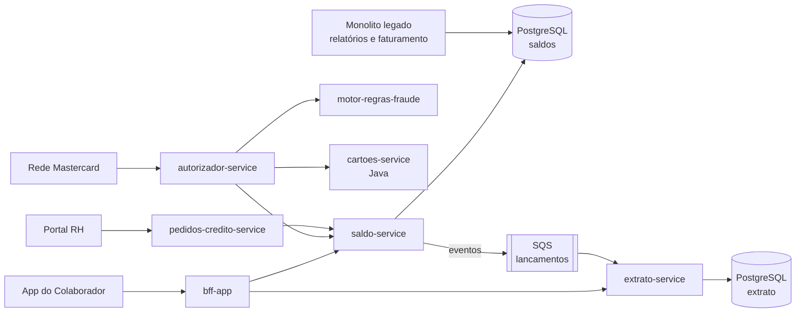

# Arquitetura

## Visão atual (as-is)

A Benefy está no meio da migração de um monolito para microsserviços. Parte do tráfego ainda passa pelo monolito.

## Infraestrutura

| Item | Tecnologia |
|---|---|
| Cloud | AWS (região `sa-east-1`) |
| Serviços | Containers no ECS Fargate; tarefas assíncronas em Lambda |
| Mensageria | SQS (com dead-letter queue em todas as filas) |
| Banco de dados | PostgreSQL (RDS), um banco por serviço |
| Arquivos | S3 (relatórios, arquivos de crédito em lote) |
| Segredos | AWS Secrets Manager |
| Infra como código | Terraform |
| Observabilidade | CloudWatch e OpenTelemetry (parcial) |

## Ferramentas de engenharia

| Para que | Ferramenta |
|---|---|
| Backlog e histórias | Azure Boards |
| Repositórios | Azure Repos (Git) |
| CI/CD | Azure Pipelines |
| Qualidade de código | SonarQube (quality gate obrigatório) |
| SAST e SCA | Veracode |
| IA no desenvolvimento | Claude Code e GitHub Copilot (uso hoje sem padrão) |

> **Espelho no GitHub:** este repositório também é mantido no GitHub. Nele, o SAST usa Semgrep e Bandit, com os mesmos critérios de bloqueio do Veracode.

## Visão alvo (to-be, fim de 2027)

- Monolito desligado.
- Todos os serviços com o mesmo template de pipeline (lint, testes, Sonar, SAST, deploy).
- **Plataforma de IA** como produto interno: agentes de refinamento, revisão, testes e documentação disponíveis para qualquer squad, configurados por um repositório central.
- Toda execução de agente rastreada (custo, resultado, decisão humana) e auditável.

## Ambiente de homologação local

O banco de homologação roda na sua máquina em Docker: um PostgreSQL com um schema por área da empresa e dados sintéticos de agosto a outubro de 2026. Como subir e o que tem em cada tabela: [banco de dados](../dados/banco-de-dados.md).

Serviços novos ficam em `services/`, um diretório por serviço. O monolito e os serviços dos demais squads continuam nos repositórios de origem no Azure Repos.

## Como os dados fluem

- O `pedidos-credito-service` recebe o pedido do RH da empresa cliente e, no dia do crédito, chama o `saldo-service`.
- O `autorizador-service` decide cada compra e chama o `saldo-service` para debitar.
- Toda alteração de saldo publica um evento `lancamento_criado` na fila SQS. O `extrato-service` consome a fila e grava o lançamento.
- Se a fila falha, as mensagens vão para a DLQ e precisam ser reprocessadas. Até lá, o saldo e o extrato ficam diferentes.
