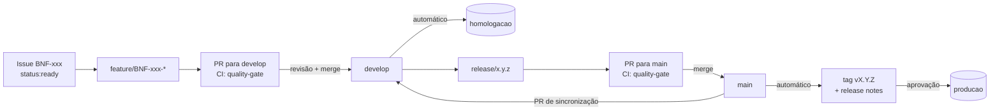

# Fluxo de entrega

Caminho de uma demanda do backlog até a produção. Vale para todos os squads, inclusive para código escrito com ajuda de IA. Os padrões de código e o quality gate estão em [Padrões de engenharia](05-padroes-de-engenharia.md).

## 1. Da história ao PR

1. A história entra na sprint com `status:ready`, ou seja, atende a Definition of Ready.
2. O dev cria `feature/BNF-xxx-descricao-curta` a partir da `develop`.
3. Commits seguem Conventional Commits com o ID da história, por exemplo `feat(saldo): ... [BNF-101]`.
4. O PR é aberto contra a `develop`, com o template preenchido e `Closes #<issue>` para fechar a issue no merge.

## 2. Quality gate e revisão

- O CI roda em todo PR. O check `quality-gate` é obrigatório: sem ele verde, o merge fica bloqueado.
- Pelo menos um revisor humano analisa o PR. Comentários bloqueantes e conversas abertas impedem o merge.
- Agentes de IA podem comentar, mas não aprovam nem fazem merge.
- O merge é feito com **merge commit**, que preserva o histórico da feature.

## 3. Homologação

Todo merge na `develop` dispara o workflow **Homologação**, que constrói as imagens dos serviços e registra o deploy no environment `homologacao`. A validação funcional acontece nesse ambiente, junto com o PO.

## 4. Release

1. O tech lead cria `release/x.y.z` a partir da `develop`, seguindo o versionamento semântico:
   - **maior:** mudança incompatível de API;
   - **menor:** funcionalidade nova;
   - **correção:** ajuste sem funcionalidade nova.
2. Na branch de release entram só correções de estabilização.
3. O PR `release/x.y.z` → `main` passa pelo mesmo quality gate.
4. O merge na `main` dispara o workflow **Release**:
   - **versionar** cria a tag `vX.Y.Z` e a release com as notas geradas a partir dos PRs;
   - **deploy-producao** espera a aprovação de um revisor do environment `producao` e então constrói as imagens da versão.
5. Depois do deploy, um PR `main` → `develop` sincroniza a `develop` com o merge da release.

A `main` só aceita merge de `release/*` e `hotfix/*`. Qualquer outra origem faz o workflow de release falhar.

## 5. Hotfix

1. Uma correção urgente em produção sai de `hotfix/BNF-xxx-descricao`, criada a partir da `main`.
2. O PR vai direto para a `main`, com o mesmo quality gate e revisão.
3. O workflow de release incrementa a versão de correção (`v1.4.0` → `v1.4.1`) e segue para a aprovação de produção.
4. Em seguida, um PR `main` → `develop` leva a correção para a `develop`.

Mudanças que afetam a autorização de compras também precisam da aprovação do CAB (quinta-feira) antes do merge na `main`.

## Proteções do repositório

| Proteção | Onde |
|---|---|
| Push direto, force push e exclusão bloqueados em `main` e `develop` | Ruleset `protecao-main-develop` |
| PR obrigatório, com conversas resolvidas, e check `quality-gate` verde | Ruleset `protecao-main-develop` |
| Deploy em produção só a partir da `main` e com aprovação | Environment `producao` |
| Deploy em homologação só a partir da `develop` | Environment `homologacao` |
